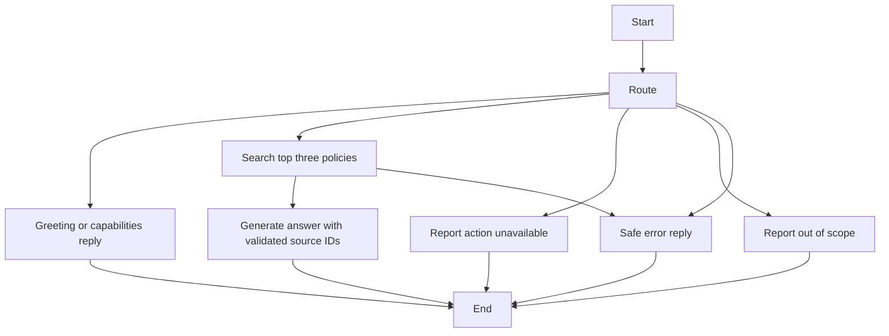

# SecureSupport

## A Guardrailed Agentic Customer Support System

Foundation, synthetic domain data, knowledge retrieval, and a single-turn agent,
using Python 3.11+.
There is no complaint CRUD, persistent conversation memory, API server, or frontend
application yet.

## Local setup

Run these commands from the SecureSupport project root:

```sh
python3 -m venv .venv
source .venv/bin/activate
python -m pip install -r requirements.txt
cp .env.example .env
```

No API key is required for the foundation. Do not commit real keys.
The validation and unit tests make no OpenAI API calls. Live retrieval commands do.

## Configuration

`app/config.py` defines a Pydantic `Settings` class. Instantiate it when needed:

```python
from app.config import Settings

settings = Settings()
```

It reads `SECURESUPPORT_` environment variables and an optional `.env` file
relative to the current working directory. Environment variables override `.env`.
Defaults are development mode, debug disabled, and no OpenAI API key.
An optional key uses `SecretStr` to mask it in normal representations.

## Folder structure

- `app/`: Python package and configuration.
- `app/schemas/`: validated synthetic domain models.
- `app/agent/`: LangGraph state, routing, nodes, model integration, and live factory.
- `app/retrieval/`: OpenAI embeddings and persistent Chroma search.
- `app/tools/`: reserved for future support tools.
- `app/guardrails/`: reserved for future guardrails.
- `data/`: synthetic support fixtures.
- `evaluation/`: labeled retrieval cases and ranking metrics.
- `tests/`: fixture validation and invalid-input checks.
- `scripts/`: fixture validation utilities.
- `frontend/`: reserved for the future user interface.

## Planned future stack

OpenAI, LangGraph, Pydantic, Chroma, SQLite/SQLAlchemy, FastAPI, Streamlit,
Pytest, and Docker. This stage installs Pydantic Settings, OpenAI, Chroma, and LangGraph.
The API, database actions, persistent memory, and UI are deferred.

See `DECISIONS.md` for foundation decisions. Run `git status` to inspect the
current changes.

## Synthetic data

`data/synthetic_support.json` contains fictional users, payments, tickets,
knowledge articles, complaints, and six deliberate failure prompts. All policies
are demo policies, not production commitments. Emails use the reserved `.invalid`
domain; no credentials or real customer information are included. Amounts are
integer AUD cents. These fixtures are not an authentication mechanism.

After installing the requirements in your local virtual environment, run:

```sh
python -m scripts.validate_data
python -m unittest discover -s tests -v
```

Validation checks field constraints, duplicate IDs, foreign references, and
complaint ownership. Failure prompts are evaluation inputs with expected behavior;
they do not constitute an implemented or tested agent guardrail.

Next: add SQLite-backed support tools, then checkpointing and human approval.

## Knowledge retrieval

Activate the local Python 3.11+ virtual environment and install requirements.
Set `SECURESUPPORT_OPENAI_API_KEY` in your local `.env`; do not share or commit it.
`SECURESUPPORT_EMBEDDING_MODEL` defaults to `text-embedding-3-small`.
`SECURESUPPORT_CHROMA_PATH` defaults to the project’s `data/chroma` directory.
Run commands from the project root so `.env` and any relative path resolve there.

```sh
python -m scripts.index_knowledge
python -m scripts.search_knowledge "How do I request a refund?"
python -m evaluation.retrieval
```

These commands send knowledge-article text or search queries to OpenAI and incur
embedding usage. Only the knowledge-base articles are indexed, never user, payment,
ticket, or complaint records. Queries should not contain secrets or personal data.
Chroma receives explicit vectors, so it does not download a default embedding model.
The generated index is ignored by Git. Each corpus/model version gets a distinct
collection; unchanged complete indexes are reused without re-embedding. Old versions
remain locally until you remove the generated index directory.

Search returns source IDs, titles, policy text, and cosine distances (lower is
closer). Distance is not a probability of correctness. Search does not generate
answers, perform support actions, or enforce authorization. It always returns
nearest articles; out-of-scope rejection and calibrated relevance thresholds are
future agent/guardrail work.

The 12 labeled queries provide a small smoke evaluation: Hit@1, Hit@3, and MRR@3.
MRR@3 gives zero when no relevant source appears in the first three results.
This is a demo set, not a production accuracy benchmark. Unit tests use fixed
test vectors and a mocked OpenAI response; they test integration and metric math,
not live semantic quality.

References: [OpenAI embeddings API](https://developers.openai.com/api/reference/python/resources/embeddings/methods/create),
[Chroma adding data](https://docs.trychroma.com/docs/collections/add-data),
[Chroma queries](https://docs.trychroma.com/docs/querying-collections/query-and-get).

## Verified live retrieval result

The first live 12-query evaluation scored Hit@1 = 11/12 (91.7%),
Hit@3 = 12/12 (100%), and MRR@3 = 0.9583. See
`evaluation/reports/retrieval_live.json` for per-query results and run metadata.
The question about viewing another customer’s payment records ranked the pending
payment article first and the expected privacy article second. Keep multiple
sources available to the later agent; privacy and authorization must be enforced
independently of retrieval ranking. These results cover this small demo corpus only.

## Single-turn support agent

The LangGraph workflow routes one message through one of four branches.
`SECURESUPPORT_CHAT_MODEL` defaults to `gpt-4.1-mini` and can be configured in
your private `.env`. The router and policy answer use structured OpenAI Responses
outputs, with response storage disabled for those calls.



```sh
python -m scripts.index_knowledge
python -m scripts.chat "Hello"
python -m scripts.chat "How do I request a refund?"
python -m scripts.chat "Refund pay_001"
python -m unittest discover -s tests -v
```

Each chat command is independent: there is no conversation history, authentication,
checkpoint, interrupt, or resume yet. Questions and retrieved policy text are sent
to OpenAI and incur usage. Greeting and action-unavailable branches do not access
the knowledge index. The tool branch performs no lookup, write, refund, or escalation.
All responses report `action_performed: false`.

The response includes route, status, answer, and source IDs. Policy answers require
at least one source from the retrieved set. Invented or absent source IDs, empty
retrieval results, and self-reported insufficient evidence produce an insufficient
context reply. Dependency failures produce a generic error without SDK exception
details. Source-ID validation proves traceability, not that every claim is supported.
Safety rules in prompts are preliminary; dedicated input/output guardrails and
authorization enforcement are still later stages. Nearest-neighbor retrieval still
has no calibrated relevance cutoff.

Five live smoke cases cover greeting, refund policy, cross-customer privacy policy,
a refund action request, and an unrelated investment request. Their route/status
checks and actual answers are saved in `evaluation/reports/agent_live_smoke.json`.
These smoke cases do not establish general routing accuracy or guardrail robustness.
The earlier retrieval report records its original corpus and case hashes; ASCII
cleanup and later edits mean it is historical rather than a score for every newer
version of the data.

Implementation references: [LangGraph Graph API](https://docs.langchain.com/oss/python/langgraph/graph-api),
[OpenAI structured outputs](https://developers.openai.com/api/docs/guides/structured-outputs),
[GPT-4.1 mini](https://developers.openai.com/api/docs/models/gpt-4.1-mini).
